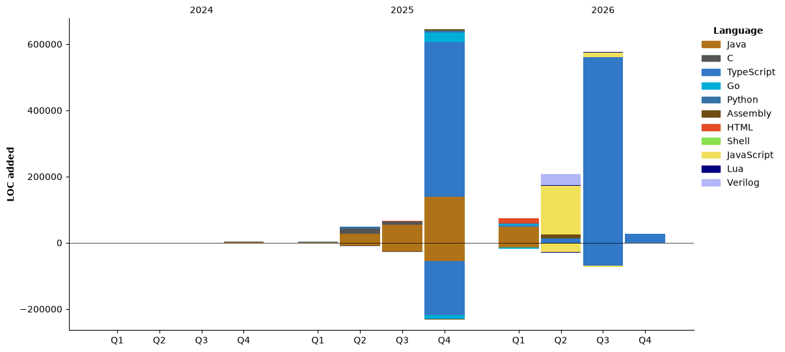

[](https://git.io/typing-svg)

<div align="center">
  <h1>Data to my stalkers 👇</h1>
</div>

<!--START_SECTION:waka-->


**🐱 My GitHub Data** 

> 📦 153.0 kB Used in GitHub's Storage 
 > 
> 🏆 580 Contributions in the Year 2026
 > 
> 🚫 Not Opted to Hire
 > 
> 📜 18 Public Repositories 
 > 
> 🔑 21 Private Repositories 
 > 
**I'm a Night 🦉** 

```text
🌞 Morning                841 commits         ███░░░░░░░░░░░░░░░░░░░░░░   12.65 % 
🌆 Daytime                1610 commits        ██████░░░░░░░░░░░░░░░░░░░   24.22 % 
🌃 Evening                2102 commits        ████████░░░░░░░░░░░░░░░░░   31.62 % 
🌙 Night                  2095 commits        ████████░░░░░░░░░░░░░░░░░   31.51 % 
```
📅 **I'm Most Productive on Tuesday** 

```text
Monday                   1054 commits        ████░░░░░░░░░░░░░░░░░░░░░   15.85 % 
Tuesday                  1280 commits        █████░░░░░░░░░░░░░░░░░░░░   19.25 % 
Wednesday                847 commits         ███░░░░░░░░░░░░░░░░░░░░░░   12.74 % 
Thursday                 918 commits         ███░░░░░░░░░░░░░░░░░░░░░░   13.81 % 
Friday                   858 commits         ███░░░░░░░░░░░░░░░░░░░░░░   12.91 % 
Saturday                 777 commits         ███░░░░░░░░░░░░░░░░░░░░░░   11.69 % 
Sunday                   914 commits         ███░░░░░░░░░░░░░░░░░░░░░░   13.75 % 
```


📊 **This Week I Spent My Time On** 

```text
🕑︎ Time Zone: America/Recife

💬 Programming Languages: 
Markdown                 26 mins             ██████████████░░░░░░░░░░░   57.15 % 
Java                     19 mins             ███████████░░░░░░░░░░░░░░   42.85 % 

🔥 Editors: 
Obsidian                 26 mins             ██████████████░░░░░░░░░░░   57.15 % 
Zed                      19 mins             ███████████░░░░░░░░░░░░░░   42.85 % 

🐱‍💻 Projects: 
estudos                  26 mins             ██████████████░░░░░░░░░░░   57.15 % 
sara-emprega             19 mins             ███████████░░░░░░░░░░░░░░   42.85 % 

💻 Operating System: 
Linux                    45 mins             █████████████████████████   100.00 % 
```

🤖 **AI Coding This Week** 

```text
No AI Coding Activity Tracked This Week
```

**Timeline**




 Last Updated on 07/11/2026 16:23:35 UTC
<!--END_SECTION:waka-->

---

<div align="center">

<h2> Gruvbox lover ♥️ <br> Studying →  GTK & React⚛️!!

<br>

<!-- [](https://skillicons.dev) -->


</div>

