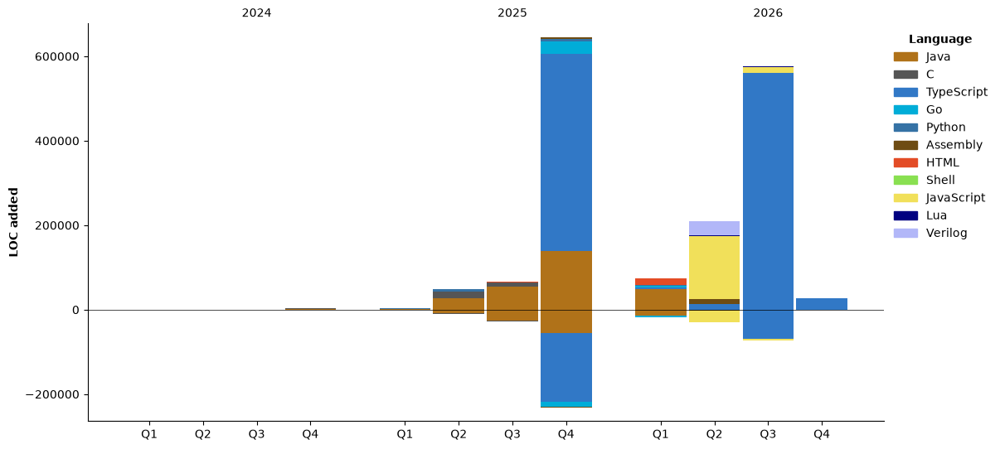

[](https://git.io/typing-svg)

<div align="center">
  <h1>Data to my stalkers 👇</h1>
</div>

<!--START_SECTION:waka-->


**🐱 My GitHub Data** 

> 📦 153.0 kB Used in GitHub's Storage 
 > 
> 🏆 580 Contributions in the Year 2026
 > 
> 🚫 Not Opted to Hire
 > 
> 📜 18 Public Repositories 
 > 
> 🔑 21 Private Repositories 
 > 
**I'm a Night 🦉** 

```text
🌞 Morning                846 commits         ███░░░░░░░░░░░░░░░░░░░░░░   12.68 % 
🌆 Daytime                1613 commits        ██████░░░░░░░░░░░░░░░░░░░   24.18 % 
🌃 Evening                2108 commits        ████████░░░░░░░░░░░░░░░░░   31.60 % 
🌙 Night                  2103 commits        ████████░░░░░░░░░░░░░░░░░   31.53 % 
```
📅 **I'm Most Productive on Tuesday** 

```text
Monday                   1057 commits        ████░░░░░░░░░░░░░░░░░░░░░   15.85 % 
Tuesday                  1282 commits        █████░░░░░░░░░░░░░░░░░░░░   19.22 % 
Wednesday                851 commits         ███░░░░░░░░░░░░░░░░░░░░░░   12.76 % 
Thursday                 922 commits         ███░░░░░░░░░░░░░░░░░░░░░░   13.82 % 
Friday                   865 commits         ███░░░░░░░░░░░░░░░░░░░░░░   12.97 % 
Saturday                 779 commits         ███░░░░░░░░░░░░░░░░░░░░░░   11.68 % 
Sunday                   914 commits         ███░░░░░░░░░░░░░░░░░░░░░░   13.70 % 
```


📊 **This Week I Spent My Time On** 

```text
🕑︎ Time Zone: America/Recife

💬 Programming Languages: 
Markdown                 4 hrs 56 mins       █████████████████████████   99.92 % 
Java                     0 secs              ░░░░░░░░░░░░░░░░░░░░░░░░░   00.08 % 

🔥 Editors: 
Obsidian                 4 hrs 56 mins       █████████████████████████   99.92 % 
Zed                      0 secs              ░░░░░░░░░░░░░░░░░░░░░░░░░   00.08 % 

🐱‍💻 Projects: 
estudos                  4 hrs 56 mins       █████████████████████████   99.92 % 
sara-emprega             0 secs              ░░░░░░░░░░░░░░░░░░░░░░░░░   00.08 % 

💻 Operating System: 
Linux                    4 hrs 56 mins       █████████████████████████   100.00 % 
```

🤖 **AI Coding This Week** 

```text
No AI Coding Activity Tracked This Week
```

**Timeline**




 Last Updated on 17/11/2026 19:09:41 UTC
<!--END_SECTION:waka-->

---

<div align="center">

<h2> Gruvbox lover ♥️ <br> Studying →  GTK & React⚛️!!

<br>

<!-- [](https://skillicons.dev) -->


</div>

